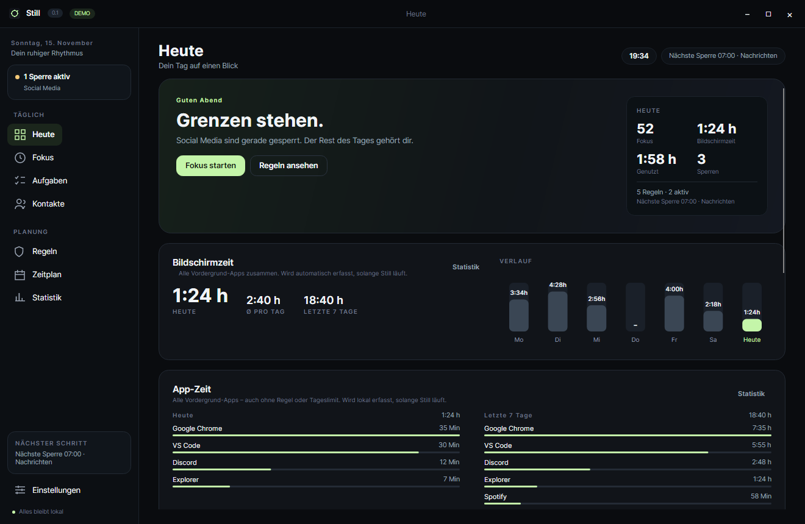
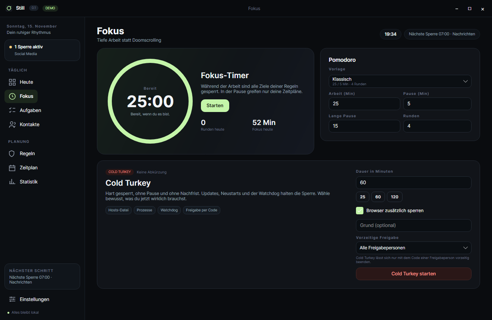
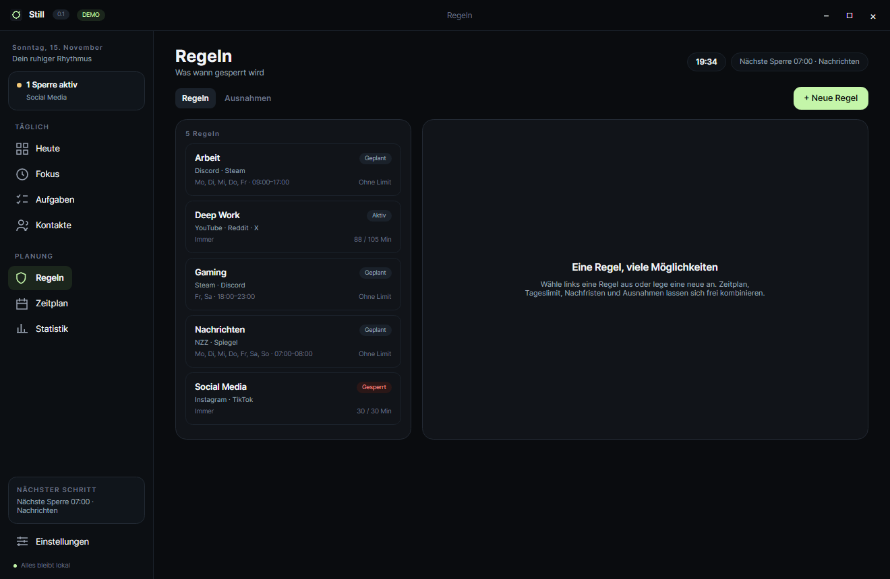
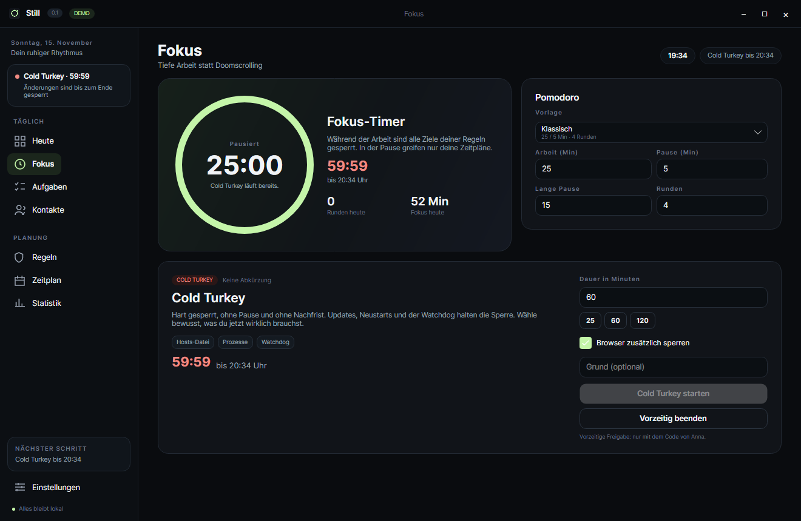
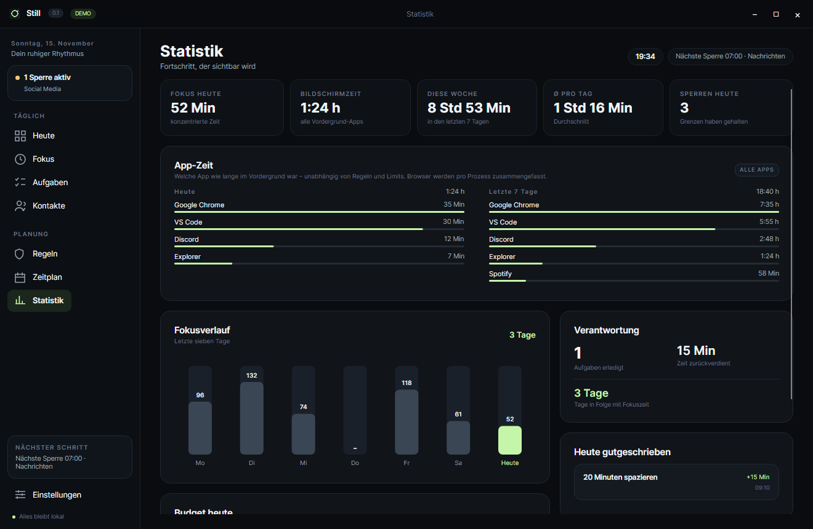
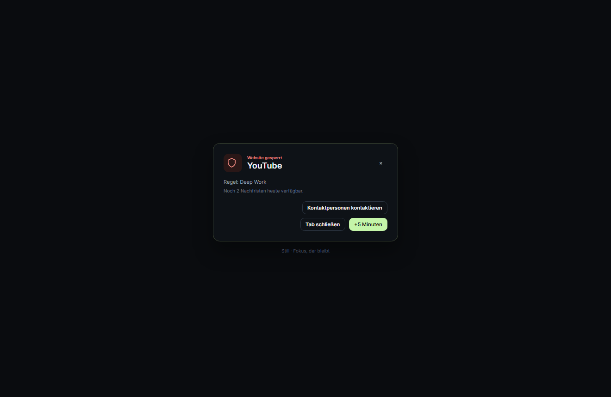
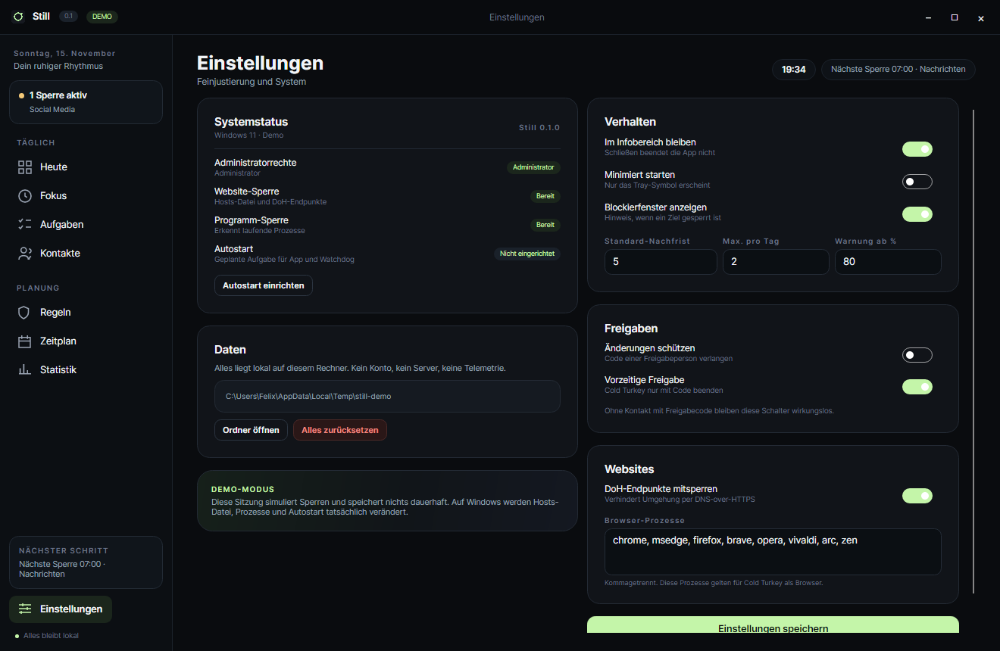

# Still

[English README](README.md)

Still ist eine leichte Fokus-App für Windows. Sie sperrt Programme und Websites, verbindet Zeitpläne mit Tageslimits, macht Aufgaben zu Zeitbelohnungen und lässt sich durch Menschen absichern, statt durch einen Account auf einem Server.

> **Status 0.1.0.** Windows zuerst. Die Oberfläche und der Core laufen auch unter Linux/macOS; dort ist das Sperren bewusst nur simuliert. Die Windows-App wurde installiert; Overlay, Kontakt und Nachfrist wurden mit echten Anwendungen geprüft. Hosts-Schreibrechte und Scheduled Tasks wurden nicht mit Administratorrechten durchgespielt; die Hosts-Transformation und die Overlay-Logik sind durch Tests abgesichert.



## Was drin ist

| Bereich | Verhalten |
| --- | --- |
| **Regeln** | Programme und Websites blockieren – dauerhaft oder an ausgewählten Wochentagen in Zeitfenstern. Programme können direkt aus dem Programme-Ordner gewählt werden; der Prozessname bleibt als manuelle Option erhalten. Ein Tageslimit ist optional. |
| **Limits & Nachfrist** | Nutzung wird sekundengenau im Vordergrund gezählt. Bei erreichtem Limit gibt es pro Regel eine konfigurierbare Nachfrist (standardmäßig 5 Minuten, begrenzt pro Tag) – der klassische „+5 Minuten“-Knopf. |
| **Nutzung** | Pro Regel wird verbrauchte und verbleibende Zeit angezeigt, dazu die Bildschirmzeit des Tages. Bildschirmzeit zählt, solange irgendeine App im Vordergrund ist. |
| **App-Zeit** | Zusätzlich wird die Vordergrundzeit pro App lokal für heute und die letzten sieben Tage erfasst – unabhängig von Regeln und Tageslimits. Die Summe ist über den Startscreen und die Statistik sichtbar; Browser werden pro Prozess zusammengefasst, nicht pro Tab. |
| **Ausnahmen** | Globale Whitelists mit eigenem Zeitfenster. Sie überschreiben alle Regeln und zählen nicht ins Budget. |
| **Fokus-Timer** | Pomodoro-Timer im Stil von „Pandora“: Arbeitsphasen sperren alle Ziele deiner Regeln, Pausen heben nur die Timer-Sperre auf. Zeitpläne bleiben in Pausen aktiv. |
| **Aufgaben** | Aufgaben bringen Bonuszett für eine Regel oder alle Regeln mit Tageslimit. Optional mit kurzer Notiz als Nachweis. Maximalzahl pro Tag pro Aufgabe. |
| **Kontakte** | Freigabepersonen mit lokalem, per PBKDF2 gehashtem Code. Der Code gibt Änderungen oder eine vorzeitige Cold-Turkey-Freigabe frei. Kein Konto, kein Server. |
| **Cold Turkey** | Harte Sperre ohne Pause und ohne Nachfrist. Optional lässt sie sich nur mit dem Code einer Freigabeperson vorzeitig beenden (Einstellungen → Freigaben). Browser können zusätzlich gesperrt werden. Ein Watchdog startet die App neu, die Hosts-Sperre überlebt einen Neustart. |
| **Statistik** | Fokusminuten, Bildschirmzeit, App-Zeit, Sperrversuche, erledigte Aufgaben, Regelbudgets und die letzten sieben Tage. |
| **Autostart** | Wird aus den Einstellungen als Scheduled Task für App und Watchdog eingerichtet. |
| **Browser-Extension** | Chrome/Edge und Firefox blenden beim Sperren einer Website dieselbe Karte wie bei Apps ein: Regel, Nachfrist, „Kontaktpersonen kontaktieren“ und Schließen. Sie deckt auch Subdomains ab. |

## Ein Blick in die App

| | |
| --- | --- |
|  |  |
|  |  |
|  |  |
|  |  |

Alle Bilder entstehen deterministisch aus dem Demo-Datensatz (siehe [Entwickeln](#entwickeln)).

## Schnell ausprobieren

Voraussetzung: .NET 8 SDK.

```powershell
dotnet run --project src/Still.App -- --demo
```

Der Demo-Modus zeigt realistische Beispieldaten und simuliert alle Sperren. Es wird nichts auf dem System verändert. Die Demo-Daten bleiben im Arbeitsspeicher; als Datenpfad wird `%TEMP%\still-demo` gemeldet.

Für einen isolierten echten Datenordner:

```powershell
$env:STILL_DATA_DIR = "C:\Temp\still-data"
dotnet run --project src/Still.App
```

## Windows installieren (für Kunden)

Der fertige Installer liegt unter [GitHub Releases](https://github.com/fefi91011/still-focus/releases/latest). Lade `StillSetup-0.1.0.exe` herunter und starte sie. Die SHA-256-Prüfsumme steht in den Release-Notes.

Installer lokal bauen:

```powershell
powershell -ExecutionPolicy Bypass -File scripts/build-installer.ps1
```

Ergebnis: `dist\installer\StillSetup-0.1.0.exe`. Der Kunde muss nur diese Datei doppelklicken und den Assistenten bestätigen. Die .NET-Runtime ist enthalten, es muss nichts zusätzlich installiert werden.

Der Installer legt Startmenü- und optional Desktop-Verknüpfungen an und startet Still nach der Installation. Für Website-Sperren läuft Still dabei mit Administratorrechten. Bei späteren Starts über die Verknüpfung startet es normal; für Website-Sperren dann bitte „Als Administrator ausführen“ wählen oder den geschützten Autostart in den Einstellungen aktivieren.

Deinstallieren: **Einstellungen → Apps → Installierte Apps → Still → Deinstallieren**. Vorher Still über das Tray-Menü beenden, damit die Hosts-Sperre sauber zurückgesetzt wird.

Der Installer ist noch nicht code-signiert. Windows SmartScreen kann deshalb warnen; für eine echte Verteilung müsste er mit einem Code-Signing-Zertifikat signiert werden.

## Browser-Extension installieren

Die Extension ist optional. Sie ist für Websites gedacht, bei denen die Hosts-Sperre zu grob ist (z. B. alle YouTube-Subdomains), und zeigt die Still-Aktionen direkt im Browser.

```powershell
powershell -ExecutionPolicy Bypass -File scripts/build-extension.ps1
```

Danach in Chrome/Edge unter `chrome://extensions` bzw. `edge://extensions` den Entwicklermodus aktivieren und `dist/extension/chrome` als entpackte Erweiterung laden. In Firefox unter `about:debugging#/runtime/this-firefox` die Datei `dist/extension/firefox/manifest.json` als temporäres Add-on laden. Eine dauerhafte Firefox-Installation braucht eine Signierung durch Mozilla.

Die Extension verbindet sich ausschließlich lokal über `127.0.0.1:47821` mit der laufenden Still-App. Sie hat keinen Cloud-Zugang und keine separaten Regeln; sie liest die aktuellen Website-Sperren und Nachfristen aus Still.

## Windows veröffentlichen

Am einfachsten mit dem Skript:

```powershell
powershell -ExecutionPolicy Bypass -File scripts/publish-win.ps1
```

Das erzeugt `dist\win-x64\` mit `Still.App.exe` und `Still.Watchdog.exe`. Standardmäßig framework-dependent, also klein; auf dem Zielrechner muss die **.NET 8 Desktop Runtime** installiert sein. Für eine selbstständige Ausgabe:

```powershell
powershell -ExecutionPolicy Bypass -File scripts/publish-win.ps1 -SelfContained
```

Oder manuell:

```powershell
dotnet publish src/Still.App/Still.App.csproj -c Release -r win-x64 --self-contained false -o dist\win-x64
dotnet publish src/Still.Watchdog/Still.Watchdog.csproj -c Release -r win-x64 --self-contained false -o dist\win-x64
```

Danach `Still.App.exe` starten. Für **Website-Sperren** und das Einrichten des geschützten Autostarts wird Administratorrechte benötigt. Programm-Sperren funktionieren auch ohne Erhöhung. Der Autostart lässt sich nur aus der veröffentlichten App heraus einrichten, weil die Scheduled Task sonst nicht auf die Watchdog-Datei daneben zugreifen kann.

## Daten und Privatsphäre

Alles bleibt lokal:

- Echtbetrieb: `%LOCALAPPDATA%\Still\`
  - `state.json` und `state.bak.json`
  - `heartbeat` für den Watchdog
  - `still.log` bei Fehlern
  - App-Zeit wird in `state.json` nur lokal und pro Prozess/Tag gespeichert
- Demo: `%TEMP%\still-demo`
- Override: Umgebungsvariable `STILL_DATA_DIR`

Es gibt keine Verbindung ins Internet, keine Telemetrie und keinen Sync. Die optionale Browser-Extension spricht die App ausschließlich über die Loopback-Adresse `127.0.0.1` an. Freigabecodes werden mit PBKDF2-SHA256 (120.000 Iterationen, zufälliges Salt) gespeichert; der Klartext wird nie persistiert.

## Grenzen, bewusst und ehrlich

- **Website-Sperre über die Hosts-Datei** ist leichtgewichtig und reversibel. Sie ist kein Paketfilter und keine Firewall. Sie braucht Administratorrechte.
- **Die Hosts-Sperre deckt den exakten Host und `www.` ab.** Weitere Subdomains wie `m.youtube.com` oder `en.wikipedia.org` bleiben erreichbar, solange sie nicht separat als Ziel eingetragen sind. Für Wildcard-Sperren wäre eine Browser-Extension nötig.
- **Die Browser-Extension wirkt nur im Browser** und kann dort deaktiviert werden. Sie ist kein Ersatz für die systemweite Hosts-Sperre, sondern die feinere Ergänzung für Subdomains und die sichtbare Nachfrist.
- **DNS-over-HTTPS** wird über bekannte DoH-Endpunkte mitgesperrt. Ein Browser mit einem eigenen, unbekannten DoH-Anbieter kann das umgehen. Für v1 ist das eine dokumentierte Grenze, keine falsche Sicherheitsversprechung.
- **Programm-Sperre** pollt etwa einmal pro Sekunde und zeigt ein Vollbild-Overlay über dem Bildschirm. Die blockierte App wird nicht mehr automatisch beendet; sie lässt sich nur über „App schließen“ schließen. Geschützte Systemprozesse werden nie angefasst.
- **Nutzungszeit** wird pro Regel über Vordergrundprozesse erfasst. Website-Nutzung wird über den Vordergrund-Browser angenähert, nicht pro Tab gemessen.
- **Bildschirmzeit** zählt jede Vordergrund-App, solange Still läuft. Zusätzlich wird die Vordergrundzeit pro Prozess lokal für heute und die letzten sieben Tage gespeichert; Browser werden dabei pro Prozess, nicht pro Tab zusammengefasst. Leerlauf oder der Sperrbildschirm können in der Gesamtzeit mitzählen. Bei geschlossenem Still wird nichts erfasst.
- **Cold Turkey** kann von einem Administrator mit Task-Manager-Gewalt beendet werden. Still verhindert das nicht mit einem Kernel-Treiber. Die Hosts-Sperre bleibt jedoch bestehen, und der Watchdog startet die App bei fehlendem Heartbeat neu. Das ist die bewusste v1-Grenze: stark, aber kein DRM.
- **Vorzeitige Freigabe** ist optional und doppelt abgesichert: Sie muss in den Einstellungen aktiviert sein, und es braucht eine Freigabeperson mit Code. Ist sie aus, gibt es in der Oberfläche keinen Ausstieg. Die freigebende Kontaktperson lässt sich während der Sperre weder löschen noch ändern.
- **Kein Windows-Dienst.** Die App läuft als Tray-Anwendung, der Watchdog als Scheduled Task. Das ist leichter zu installieren und zu debuggen als ein Dienst mit IPC.
- **Andere Betriebssysteme:** `Still.Core` und die Avalonia-Oberfläche sind portabel. Unter Linux/macOS liefert `NullPlatform` keine echte Sperre; dort ist die App derzeit eine Demo. Die Erweiterung auf macOS (LaunchAgents/EndpointSecurity) oder Linux (systemd/cgroups) ist vorbereitet, aber nicht implementiert.

## Architektur

```
src/
  Still.Core/       Regeln, Limits, Timer, Aufgaben, Freigaben, Persistenz, Engine
  Still.Platform/   Windows: Hosts, Prozesse, Elevation, Scheduled Tasks; NullPlatform
  Still.App/        Avalonia 11 UI, Tray, Vollbild-Blockierfenster, Demo-Modus
  Still.Watchdog/   startet die App neu, wenn der Heartbeat fehlt
tests/
  Still.Core.Tests/ 48 Tests für Engine, App-Zeitmessung, Zeitpläne, Limits,
                   Freigaben, Persistenz und die hosts-Datei-Transformation
extension/          Chrome/Firefox-WebExtension mit lokaler Still-Blockseite
tools/
  Still.Screenshots/ Headless-Renderer für die Oberfläche
```

Die zentrale Entscheidung: `Still.Core` enthält die gesamte Logik und kennt kein Windows. `Still.Platform` implementiert nur die drei Fähigkeiten `IProcessController`, `IWebsiteBlocker` und `IStartupInstaller`. Die App orchestriert beides über `StillRuntime`.

Eine Regel wird pro Tick ausgewertet. Der `FocusEngine` kombiniert:

1. Zeitplan aktiv?
2. Tageslimit inklusive Bonus aus Aufgaben und Nachfristen aufgebraucht?
3. Cold-Turkey- oder Pomodoro-Sperre aktiv?
4. Ausnahme für das konkrete Ziel aktiv?

Daraus entstehen die Mengen der zu sperrenden Prozesse und Domains. Die Platform wendet sie an; die UI liest nur den Snapshot.

## Entwickeln

```bash
dotnet build Still.sln
dotnet test tests/Still.Core.Tests/Still.Core.Tests.csproj
```

Headless-Screenshots aller Seiten und Dialogzustände (die Bilder in `docs/screenshots` entstehen genauso):

```bash
dotnet run --project tools/Still.Screenshots -- artifacts/screenshots
```

Unter Linux benötigt der Renderer Skia-NativeAssets und eine Font-Konfiguration. Auf Windows ist das nicht nötig. Die Screenshots in diesem README wurden mit dem Demo-Datensatz erzeugt.

## Was noch fehlt

- Ein Windows-Durchlauf mit Administratorrechten: Hosts-Schreibrechte im Alltag, Vollbild-Overlay über echten Anwendungen, Tray-Verhalten und Scheduled Tasks. Ohne Erhöhung bleibt das bewusst ungetestet, weil es das laufende System verändert.
- Code-Signierung und automatische Updates für eine echte Verteilung.
- Import/Export und ein optionaler Passwort-Reset-Weg für Kontakte.
- Weitere Plattformen hinter dem vorhandenen `IPlatform`-Interface.

Still ist absichtlich klein gehalten: eine Tray-App, eine JSON-Datei, keine Cloud.
