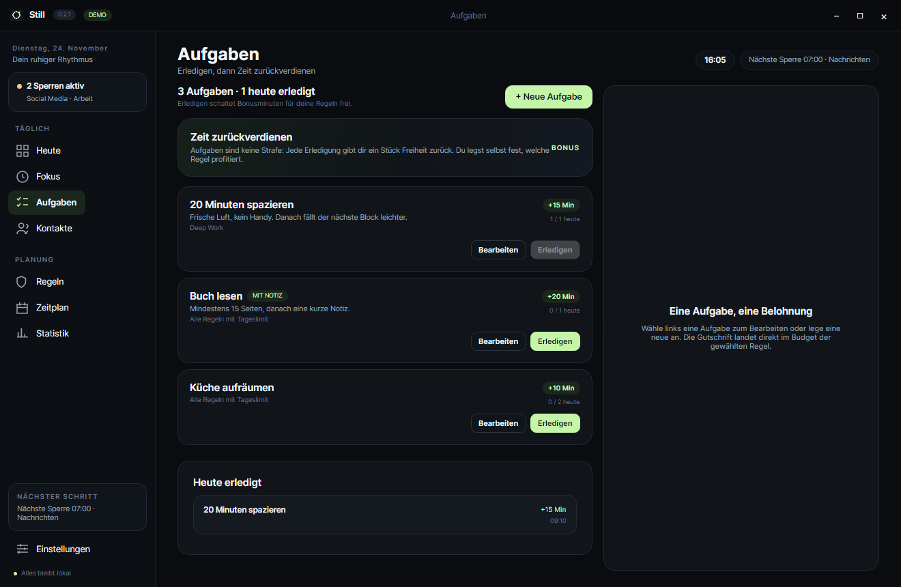

# Still

[English README](README.md)

Still ist eine leichte Fokus-App für Windows. Sie sperrt Programme und Websites, verbindet Zeitpläne mit Tageslimits, macht Aufgaben zu Zeitbelohnungen und lässt sich durch Menschen absichern, statt durch einen Account auf einem Server.

> **Status 0.2.1.** Windows zuerst. Die Oberfläche und der Core laufen auch unter Linux/macOS; dort ist das Sperren bewusst nur simuliert. Website-Sperren laufen jetzt über die mitgelieferte Browser-Erweiterung; die hosts-Datei wird nur noch beim Update von älteren Versionen bereinigt. Installer, Overlay, Kontakt, Nachfrist und die Extension-Brücke wurden lokal geprüft. Scheduled Tasks brauchen noch eine breitere Prüfung mit Administratorrechten. Die Oberfläche ist deutsch; die Dokumentation ist englisch.


## Was drin ist

| Bereich | Verhalten |
| --- | --- |
| **Regeln** | Programme und Websites blockieren – dauerhaft oder an ausgewählten Wochentagen in Zeitfenstern. Programme können direkt aus dem Programme-Ordner gewählt werden; der Prozessname bleibt als manuelle Option erhalten. Ein Tageslimit ist optional. |
| **Limits & Nachfrist** | Nutzung wird sekundengenau im Vordergrund gezählt. Bei erreichtem Limit gibt es pro Regel eine konfigurierbare Nachfrist (standardmäßig 5 Minuten, begrenzt pro Tag) – der klassische „+5 Minuten“-Knopf. |
| **Nutzung** | Pro Regel wird verbrauchte und verbleibende Zeit angezeigt, dazu die Bildschirmzeit des Tages. Die Heute-Seite zeigt die Apps und Websites aus aktiven Regeln mit Icons. Bildschirmzeit zählt, solange irgendeine App im Vordergrund ist. |
| **App-Zeit** | Zusätzlich wird die Vordergrundzeit pro App lokal für heute und die letzten sieben Tage erfasst – unabhängig von Regeln und Tageslimits. Die Summe ist über den Startscreen und die Statistik sichtbar; Browser werden pro Prozess zusammengefasst, nicht pro Tab. |
| **Ausnahmen** | Globale Whitelists mit eigenem Zeitfenster. Sie überschreiben alle Regeln und zählen nicht ins Budget. |
| **Fokus-Timer** | Pomodoro-Timer im Stil von „Pandora“: Arbeitsphasen sperren alle Ziele deiner Regeln, Pausen heben nur die Timer-Sperre auf. Zeitpläne bleiben in Pausen aktiv. |
| **Aufgaben** | Aufgaben bringen Bonuszeit für eine Regel oder alle Regeln mit Tageslimit. Optional mit kurzer Notiz als Nachweis. Maximalzahl pro Tag pro Aufgabe. |
| **Kontakte** | Freigabepersonen mit lokalem, per PBKDF2 gehashtem Code. Der Code gibt Änderungen oder eine vorzeitige Cold-Turkey-Freigabe frei. Kein Konto, kein Server. |
| **Cold Turkey** | Harte Sperre ohne Pause und ohne Nachfrist. Optional lässt sie sich nur mit dem Code einer Freigabeperson vorzeitig beenden (Einstellungen → Freigaben). Browser können zusätzlich gesperrt werden. Ein Watchdog startet die App neu. |
| **Statistik** | Fokusminuten, Bildschirmzeit, App-Zeit, Sperrversuche, erledigte Aufgaben, Regelbudgets und die letzten sieben Tage. |
| **Autostart** | Wird aus den Einstellungen als Scheduled Task für App und Watchdog eingerichtet. |
| **Browser-Schutz** | Chromium- und Firefox-Erweiterungen zeigen beim Sperren einer Website dieselbe Karte wie bei Apps: Regel, Nachfrist, „Kontaktpersonen kontaktieren“ und Schließen. Sie decken Subdomains ab und verbinden sich automatisch mit der laufenden App. |

## Ein Blick in die App

| | |
| --- | --- |
|  |  |
|  |  |
|  |  |
|  |  |

Alle Bilder entstehen deterministisch aus dem Demo-Datensatz (siehe [Entwickeln](#entwickeln)).

## Schnell ausprobieren

Voraussetzung: .NET 8 SDK.

```powershell
dotnet run --project src/Still.App -- --demo
```

Der Demo-Modus zeigt realistische Beispieldaten und simuliert alle Sperren. Es wird nichts auf dem System verändert. Die Demo-Daten bleiben im Arbeitsspeicher; als Datenpfad wird `%TEMP%\still-demo` gemeldet.

Für einen isolierten echten Datenordner:

```powershell
$env:STILL_DATA_DIR = "C:\Temp\still-data"
dotnet run --project src/Still.App
```

## Windows installieren (für Kunden)

Der zuletzt veröffentlichte Installer liegt unter [GitHub Releases](https://github.com/fefi91011/still-focus/releases/latest). Lade `StillSetup-0.2.1.exe` herunter und starte sie. Die SHA-256-Prüfsumme steht in den Release-Notes.

Installer lokal bauen:

```powershell
powershell -ExecutionPolicy Bypass -File scripts/build-installer.ps1
```

Ergebnis: `dist\installer\StillSetup-0.2.1.exe`. Bei einer Erstinstallation doppelklickt der Kunde die Datei und bestätigt den Assistenten. Die .NET-Runtime ist enthalten, es muss nichts zusätzlich installiert werden.

Der Installer läuft weiterhin mit Administratorrechten, damit er nach `Program Files` schreiben und hosts-Einträge älterer Versionen entfernen kann. Programm- und Website-Sperren brauchen im Alltag keine Administratorrechte mehr; der Browser-Schutz läuft über die Erweiterung. Der Installer legt Startmenü- und optional Desktop-Verknüpfungen an und startet Still nach der Installation.

Updates laufen ohne Assistent: Still prüft höchstens einmal pro Tag die neueste GitHub-Version, lädt sie in der App herunter und startet das Setup still. Es behält dieselbe AppId und denselben Zielordner, überschreibt also die vorhandene Installation, statt eine zweite anzulegen. Sprach-, Zielordner- und Komponentenauswahl entfallen; Still startet danach neu. Windows kann einmalig nach Administratorrechten fragen, weil nach `Program Files` geschrieben wird. Auch ein manuell gestartetes Setup verwendet den bisherigen Installationsordner weiter und aktualisiert Verknüpfungen und den Eintrag unter „Installierte Apps“, statt sie zu duplizieren.

Deinstallieren: **Einstellungen → Apps → Installierte Apps → Still → Deinstallieren**. Vorher Still über das Tray-Menü beenden. Der Deinstaller entfernt alte hosts-Einträge und den Autostart; die Browser-Erweiterung wird im Browser selbst entfernt.

Der Installer ist noch nicht code-signiert. Windows SmartScreen kann deshalb warnen; für eine echte Verteilung müsste er mit einem Code-Signing-Zertifikat signiert werden.

## Browser-Schutz einrichten

Website-Sperren laufen über die Erweiterung. Still bereitet die Dateien vor und öffnet die richtige Browserseite:

1. **Einstellungen → Browser-Schutz** öffnen.
2. Bei einem erkannten Browser **Einrichten** wählen.
3. Den einmaligen Browser-Dialog bestätigen.

Die Erweiterung ist in App und Installer enthalten. Unterstützt werden:

- **Chromium:** Chrome, Edge, Brave, Vivaldi, Opera, Opera GX, Chromium, Arc
- **Firefox:** Firefox, Zen Browser, LibreWolf, Waterfox, Floorp

Pakete separat bauen:

```powershell
powershell -ExecutionPolicy Bypass -File scripts/build-extension.ps1
```

Ausgabe:

```text
dist/extension/chromium/
dist/extension/firefox/
dist/extension/still-website-blocker-chromium.zip
dist/extension/still-website-blocker-firefox.xpi
```

Manuell:

- **Chromium:** `chrome://extensions` (oder die entsprechende Seite) öffnen, Entwicklermodus aktivieren, **Entpackte Erweiterung laden** wählen und `dist/extension/chromium` auswählen.
- **Firefox:** `about:debugging#/runtime/this-firefox` öffnen, **Temporäres Add-on laden** wählen und `dist/extension/firefox/manifest.json` auswählen. Für eine dauerhafte Installation muss Mozilla die Erweiterung signieren.

Die Extension verbindet sich ausschließlich lokal über `127.0.0.1:47821` mit der laufenden Still-App. Sie hat keinen Cloud-Zugang und keine separaten Regeln; sie liest die aktuellen Website-Sperren und Nachfristen aus Still.

### Warum keine stille Installation

Normale Browser lassen eine Desktop-App keine entpackte Erweiterung still in ein bestehendes Profil legen:

- Chromium-Browser installieren automatisch nur über ihren Store oder per Enterprise-Policy auf verwalteten, Domänen-/Azure-AD-Geräten.
- Firefox braucht eine von Mozilla signierte XPI; die Policy-Installation funktioniert nur mit diesem signierten Paket.

Deshalb gibt es den einmaligen Einrichtungsschritt. Details stehen in [extension/README.md](extension/README.md).

## Windows veröffentlichen

Am einfachsten mit dem Skript:

```powershell
powershell -ExecutionPolicy Bypass -File scripts/publish-win.ps1
```

Das erzeugt `dist\win-x64\` mit `Still.App.exe` und `Still.Watchdog.exe`. Standardmäßig framework-dependent, also klein; auf dem Zielrechner muss die **.NET 8 Desktop Runtime** installiert sein. Für eine selbstständige Ausgabe:

```powershell
powershell -ExecutionPolicy Bypass -File scripts/publish-win.ps1 -SelfContained
```

Oder manuell:

```powershell
dotnet publish src/Still.App/Still.App.csproj -c Release -r win-x64 --self-contained false -o dist\win-x64
dotnet publish src/Still.Watchdog/Still.Watchdog.csproj -c Release -r win-x64 --self-contained false -o dist\win-x64
```

Danach `Still.App.exe` starten. Programm-Sperren funktionieren ohne Erhöhung. Der Autostart lässt sich nur aus der veröffentlichten App heraus einrichten, weil die Scheduled Task sonst nicht auf die Watchdog-Datei daneben zugreifen kann. Website-Sperren laufen über die Browser-Erweiterung und brauchen keine Administratorrechte.

## Daten und Privatsphäre

Alles bleibt lokal:

- Echtbetrieb: `%LOCALAPPDATA%\Still\`
  - `state.json` und `state.bak.json`
  - `heartbeat` für den Watchdog
  - `still.log` bei Fehlern
  - vorbereitete Erweiterungsdateien unter `browser-extension\`
  - App-Zeit wird in `state.json` nur lokal und pro Prozess/Tag gespeichert
- Demo: `%TEMP%\still-demo`
- Override: Umgebungsvariable `STILL_DATA_DIR`

Still selbst kontaktiert nur GitHub für die Update-Prüfung und den Update-Download. Für eine Website in einer Regel kann Still das Icon direkt bei der jeweiligen Seite anfragen (zum Beispiel `/favicon.ico`); Icons gehen nie an einen Drittanbieter. Es gibt keine Telemetrie und keinen Sync. Die optionale Browser-Extension spricht die App ausschließlich über die Loopback-Adresse `127.0.0.1` an. Freigabecodes werden mit PBKDF2-SHA256 (120.000 Iterationen, zufälliges Salt) gespeichert; der Klartext wird nie persistiert.

## Grenzen, bewusst und ehrlich

- **Website-Sperren leben im Browser.** Die Erweiterung wirkt nur in Browsern, in denen sie installiert und aktiviert ist. Sie ist kein systemweiter Paketfilter und keine Firewall und kann im Browser deaktiviert werden.
- **Kein hosts-Fallback mehr.** Still entfernt hosts-Einträge älterer Versionen beim Update und bei der Deinstallation. Neue Website-Sperren laufen immer über die Erweiterung.
- **Keine stille Extension-Installation auf normalen Browsern.** Chromium braucht Store- oder Enterprise-Verteilung, Firefox eine von Mozilla signierte XPI.
- **Programm-Sperre** pollt etwa einmal pro Sekunde und zeigt ein Vollbild-Overlay über dem Bildschirm. Die blockierte App wird nicht mehr automatisch beendet; sie lässt sich nur über „App schließen“ schließen. Geschützte Systemprozesse werden nie angefasst.
- **Nutzungszeit** wird pro Regel über Vordergrundprozesse erfasst. Website-Nutzung wird über den Vordergrund-Browser angenähert, nicht pro Tab gemessen.
- **Bildschirmzeit** zählt jede Vordergrund-App, solange Still läuft. Zusätzlich wird die Vordergrundzeit pro Prozess lokal für heute und die letzten sieben Tage gespeichert; Browser werden dabei pro Prozess, nicht pro Tab zusammengefasst. Leerlauf oder der Sperrbildschirm können in der Gesamtzeit mitzählen. Bei geschlossenem Still wird nichts erfasst.
- **Cold Turkey** kann von einem Administrator mit Task-Manager-Gewalt beendet werden. Still verhindert das nicht mit einem Kernel-Treiber. Der Watchdog startet die App bei fehlendem Heartbeat neu. Die Erweiterung kann im Browser entfernt werden. Das ist die bewusste v1-Grenze: stark, aber kein DRM.
- **Vorzeitige Freigabe** ist optional und doppelt abgesichert: Sie muss in den Einstellungen aktiviert sein, und es braucht eine Freigabeperson mit Code. Ist sie aus, gibt es in der Oberfläche keinen Ausstieg. Die freigebende Kontaktperson lässt sich während der Sperre weder löschen noch ändern.
- **Kein Windows-Dienst.** Die App läuft als Tray-Anwendung, der Watchdog als Scheduled Task. Das ist leichter zu installieren und zu debuggen als ein Dienst mit IPC.
- **Andere Betriebssysteme:** `Still.Core` und die Avalonia-Oberfläche sind portabel. Unter Linux/macOS liefert `NullPlatform` keine echte Sperre; dort ist die App derzeit eine Demo. Die Erweiterung selbst ist plattformübergreifend, die Einrichtung in Still ist Windows-first.

## Architektur

```text
src/
  Still.Core/       Regeln, Limits, Timer, Aufgaben, Freigaben, Persistenz, Engine
  Still.Platform/   Windows: Prozesse, Elevation, Scheduled Tasks; NullPlatform
  Still.App/        Avalonia 11 UI, Tray, Vollbild-Blockierfenster, Extension-Einrichtung
  Still.Watchdog/   startet die App neu, wenn der Heartbeat fehlt
tests/
  Still.Core.Tests/ 48 Tests für Engine, App-Zeitmessung, Zeitpläne, Limits,
                   Freigaben, Persistenz und die Bereinigung alter hosts-Einträge
extension/          Chromium/Firefox-WebExtension mit lokaler Still-Blockseite
tools/
  Still.Screenshots/ Headless-Renderer für die Oberfläche
```

Die zentrale Entscheidung: `Still.Core` enthält die gesamte Logik und kennt kein Windows. `Still.Platform` implementiert nur die zwei Fähigkeiten `IProcessController` und `IStartupInstaller`. Die App orchestriert beides über `StillRuntime`.

Eine Regel wird pro Tick ausgewertet. Der `FocusEngine` kombiniert:

1. Zeitplan aktiv?
2. Tageslimit inklusive Bonus aus Aufgaben und Nachfristen aufgebraucht?
3. Cold-Turkey- oder Pomodoro-Sperre aktiv?
4. Ausnahme für das konkrete Ziel aktiv?

Daraus entstehen die Mengen der zu sperrenden Prozesse und Domains. Die Platform setzt Prozesse durch; die Erweiterung liest die Domain-Menge über die Loopback-Brücke. Die UI liest nur den Snapshot.

## Entwickeln

```bash
dotnet build Still.sln
dotnet test tests/Still.Core.Tests/Still.Core.Tests.csproj
```

Headless-Screenshots aller Seiten und Dialogzustände (die Bilder in `docs/screenshots` entstehen genauso):

```bash
dotnet run --project tools/Still.Screenshots -- artifacts/screenshots
```

Unter Linux benötigt der Renderer Skia-NativeAssets und eine Font-Konfiguration. Auf Windows ist das nicht nötig. Die Screenshots in diesem README wurden mit dem Demo-Datensatz erzeugt.

## Was noch fehlt

- Code-Signierung und eine breitere Update-Testmatrix für eine echte Verteilung.
- Veröffentlichung der Erweiterung in Chrome Web Store, Edge Add-ons und addons.mozilla.org; erst damit ist eine stille oder dauerhafte Installation ohne Entwicklermodus möglich.
- Ein Windows-Durchlauf mit Administratorrechten für Scheduled Tasks und den Installer auf einem frischen System.
- Import/Export und ein optionaler Passwort-Reset-Weg für Kontakte.
- Weitere Plattformen hinter dem vorhandenen `IPlatform`-Interface.

Still ist absichtlich klein gehalten: eine Tray-App, eine JSON-Datei, keine Cloud.
